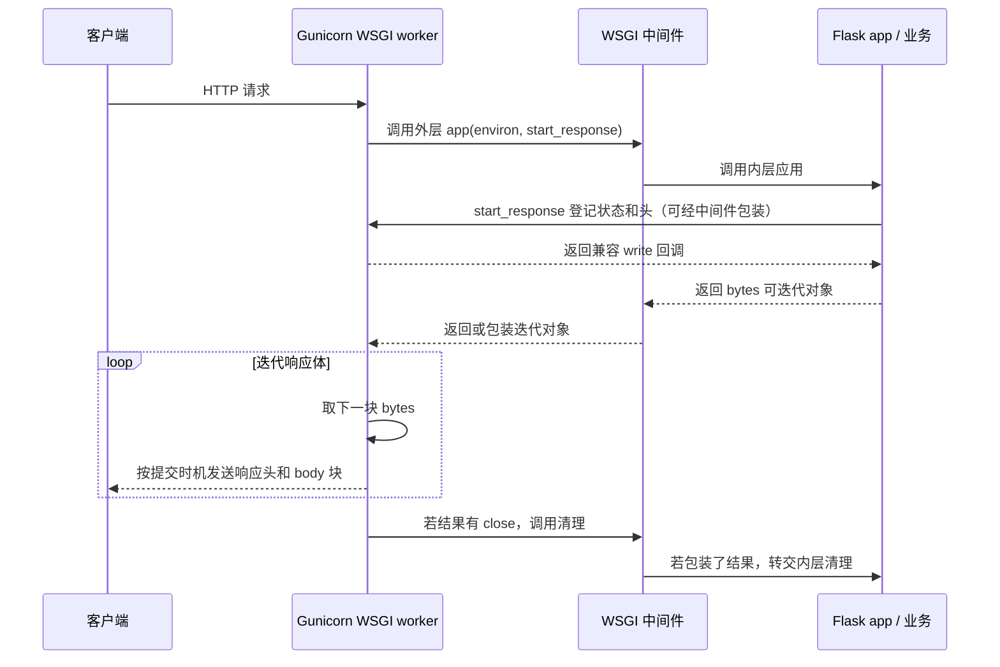

# Flask 专题

> Flask 是你简历上唯一「生产在用」的 Python Web 框架，**一定会被问得比 FastAPI 深**。好消息是项目里的真实素材很多：应用工厂按 `APP_SCOPE` 拆三个服务、gevent + SSE、上下文在 greenlet 里的坑、fork 后连接串台、优雅停机。
>
> 目录：〇、WSGI/ASGI 与服务器基础 → 〇附、WSGI 三问 → 一、基础 → 二、路由与视图 → 三、请求与响应 → 四、上下文（必考）→ 五、应用工厂与蓝图 → 六、扩展生态 → 七、流式输出与长连接 → 八、部署：Gunicorn + gevent → 九、测试 → 十、高难场景 → 十一、Flask vs FastAPI vs Django

---

## 〇、先分清：WSGI、ASGI、Gunicorn、Uvicorn 与周边组件

> 2026-10-23 补充。这一节先讲各名词属于哪一层，再看后面的分级题。项目源码与本机依赖核对：Flask 3.1.0、Gunicorn 23.0.0；项目 entrypoint 的 Web worker 默认 gevent。实际部署可被环境变量覆盖，不能把默认值当全部实例的现状。

### 1. ★ 先看全貌：它们不是同一类东西

| 层次 | 常见名字 | 负责什么 |
|---|---|---|
| 网络/应用协议 | HTTP、HTTPS、WebSocket | 浏览器与服务端怎样通信 |
| 反向代理/入口 | Nginx、Caddy、HAProxy、Apache httpd | 接入、转发、负载均衡；TLS、静态文件等能力看具体配置 |
| Python 应用服务器 | Gunicorn、Uvicorn、Waitress、Hypercorn、Daphne、uWSGI | 接收网络请求，按应用接口调用 Python 程序，发送响应 |
| 服务器与应用的接口规范 | **WSGI、ASGI** | 规定怎样传入请求、交回响应或事件；自身不是一个监听端口的服务 |
| 应用框架 | **Flask、Django、FastAPI、Starlette、Quart** | 路由、请求/响应、校验、中间件等，组织业务代码 |
| 并发执行方式 | 进程、线程、gevent greenlet、asyncio task | 一个或多个请求如何被调度 |
| 循环/解析等底层组件 | asyncio、uvloop、h11、httptools 等 | 事件调度或协议处理，不代替框架或整台应用服务器 |

框架通常提供符合规范的可调用应用对象；服务器调用这个对象。WSGI/ASGI 不是浏览器发送的协议头，也不是需要再启动的中间一层进程。

### 2. ★ 一次请求怎样走到 Flask / FastAPI？

WSGI 常见链路：

```text
浏览器 --HTTPS--> 反向代理 --HTTP/本机 socket--> Gunicorn 的 WSGI worker
                                                   |
                                             按 WSGI 规范调用
                                                   v
                                               Flask 应用
                                                   v
                                             路由、业务、数据库
```

ASGI 常见链路：

```text
浏览器 --HTTP 或 WebSocket--> 反向代理 --> Uvicorn
                                             |
                                       按 ASGI 规范调用
                                             v
                                      FastAPI / Starlette
```

反向代理可以省略，应用服务器本身通常也能监听 HTTP；是否加代理取决于部署。代理到后端常用 HTTP，并不要求链路上的每一跳都和浏览器使用相同协议/加密方式。TLS 终止位置要按实际配置判断。

### 3. ★ WSGI 是什么？

全称 **Web Server Gateway Interface**，Python Web 服务器调用应用的标准接口，典型形状为 `app(environ, start_response)`。

- `environ`：请求方法、路径、输入流等信息；它不是仅指系统环境变量。
- `start_response`：应用用它提供状态与响应头。
- 返回值：可迭代的 bytes 块，服务器遍历并发送；支持生成器流式响应，不要求一次返回完整 body。

Flask 本身是 WSGI 应用。使用同一规范，就能在多种兼容服务器之间选择；业务不必自己处理 TCP 监听和完整 HTTP 解析。[规范](https://peps.python.org/pep-3333/)

### 4. ★ ASGI 是什么？

全称 **Asynchronous Server Gateway Interface**，用异步事件接口连接服务器与应用，现代典型形状为 `async def app(scope, receive, send)`。

- `scope`：连接/请求的基本信息与类型，如 http、websocket。
- `receive`：异步取得请求体、断开等事件。
- `send`：异步发出响应开始、响应体或 WebSocket 等事件。

ASGI 适合持续收发事件，并定义生命周期相关机制；框架一般替业务封装这些底层细节。原生异步应用配合非阻塞 IO，可让事件循环在等待期间服务其他任务；CPU 重计算和阻塞调用仍会卡住循环。[接口说明](https://asgi.readthedocs.io/en/latest/introduction.html)

### 5. ★ WSGI 和 ASGI 怎么比较？

| 问题 | WSGI | ASGI |
|---|---|---|
| 应用入口 | 同步可调用对象 | 异步可调用对象/事件收发 |
| 普通 HTTP | 可以 | 可以 |
| 流式响应/SSE | 可以；需匹配并发与缓冲策略 | 可以；同样需控制背压、超时等 |
| 标准 WebSocket 接口 | 规范本身未定义 | 定义了对应事件接口 |
| 大量等待连接 | 靠线程、gevent 等部署方式承担 | 原生异步应用可在事件循环里挂起等待 |
| CPU 密集业务 | 仍需优化、隔离或多进程 | 不会因 async 自动加速 |

不要背成「WSGI 一定只能单并发」「ASGI 一定支持所有 HTTP 版本」。并发取决于执行方式，HTTP/2 等网络功能取决于服务器版本、依赖和配置；它们和应用接口是不同维度。

### 6. ★ Gunicorn 是什么？worker 又是什么？

Gunicorn 是 Python 应用服务器，也提供进程管理。经典模型是一个 master/arbiter 管多个 worker 进程，worker 才执行请求；一个 worker 内部还可采用不同并发方式。

| 模式 | 如何处理请求 | 要注意什么 |
|---|---|---|
| `sync` | 一个 worker 进程同一时刻主要处理一个请求 | 长 SSE 占一个处理槽位，连接多时容易排队 |
| `gthread` | worker 中有多个线程 | 合适的同步 IO 可并发等待；连接与线程资源有上限 |
| `gevent` | worker 中多个协作式 greenlet | IO 必须能让出执行权，CPU/未适配的阻塞调用会拖住同进程其他任务 |
| ASGI worker | 由适配的 worker 驱动 ASGI 应用 | 看 Gunicorn 版本和具体 worker，不按服务器名字猜兼容性 |

**版本边界：**本机 Gunicorn 23.0.0 的项目使用 gevent 跑 WSGI；较新官方文档已有原生 ASGI worker 内容。历史上也常通过 Uvicorn worker 跑 ASGI。因此不能笼统说「Gunicorn 永远只能跑 WSGI」。[当前设计文档](https://gunicorn.org/design/)

这里的 Web worker 和 Celery worker 是不同系统：前者接 Web 请求，后者消费 Broker 任务；`--workers 4` 也不等于仅能承受四条连接，需结合 worker 类型。

### 7. ★ Uvicorn 是什么？必须配 Gunicorn 吗？

Uvicorn 是 ASGI 应用服务器，常用来运行 FastAPI、Starlette 等。它自己可监听端口，也有多进程运行方式，**不要求先启动 Gunicorn**。

也可由 Gunicorn 管理 worker，而 Uvicorn 的 worker 实现负责 ASGI 请求处理；这是一个部署组合，不是默认要多绕一层独立反向代理。

旧教程的 `uvicorn.workers.UvicornWorker` 已被 Uvicorn 文档标为弃用；采用该组合时核对独立 `uvicorn-worker` 包的 `uvicorn_worker.UvicornWorker`。若使用 Gunicorn 自带的新 ASGI 实现，则另按该版本配置，不混抄三种命令。[部署文档](https://uvicorn.dev/deployment/)、[独立 worker](https://github.com/Kludex/uvicorn-worker)

### 8. ★ Flask 和 FastAPI 与服务器是什么关系？

Flask 是框架，Gunicorn 是运行它的一种服务器，两者不是替代品。FastAPI 是框架，Uvicorn 是运行它的一种 ASGI 服务器，也不是一个软件的两个名字。

| 框架/工具 | 常见接口与定位 |
|---|---|
| Flask | WSGI 框架；支持一定范围的 async 视图，不因此变成原生 ASGI 框架 |
| Django | 提供 WSGI / ASGI 入口；业务与中间件是否异步还需逐项看 |
| Starlette | ASGI 工具包/框架，提供路由、中间件等 |
| FastAPI | 基于 Starlette 等组件组织的 ASGI 框架，提供校验和 API 文档能力 |
| Quart | 与 Flask API 风格相近的 ASGI 框架，不是给 Flask 简单换个启动参数 |
| Werkzeug | Flask 依赖的 WSGI 工具库，也提供开发服务器，不是 Gunicorn 的别名 |

### 9. ★ Flask 写 async def 是「假异步」吗？

这种说法不准确。安装 async 支持后，视图里的 await 确实能组织异步 IO；但在常规 WSGI 部署中，请求仍占着相应执行槽位，不能仅靠改函数定义获得原生 ASGI 的连接调度方式。

视图结束后临时事件循环也可能结束，不要依赖其中 create_task 的任务永久继续；可靠后台工作使用任务队列等明确机制。完整异步方案还要检查数据库/HTTP 客户端和所有中间件是否阻塞。[Flask 官方解释](https://flask.palletsprojects.com/en/stable/async-await/)

### 10. ★ gevent 和 asyncio 是一回事吗？

不是。gevent 基于 greenlet，在可协作的 IO 处切换，常通过提前 monkey patch 保留同步代码外观；asyncio 用 async/await 与兼容的异步库表达挂起点。

二者都能在等待网络时服务其他任务，但不能随意混用事件循环与客户端。项目 psycopg2 是 C 扩展，单靠 patch Python socket 不够，`app/sitecustomize.py` 还调用 psycogreen；不能把它理解成项目已经改用 asyncpg。

### 11. 还有哪些服务器？需要都学吗？

| 名字 | 定位与常见使用点 |
|---|---|
| Waitress | WSGI 服务器，常用多线程，直接支持 Windows |
| uWSGI | 支持部署 Python 等应用的服务器套件，配置能力多；与 WSGI 规范不是同一个词 |
| Hypercorn | 常见 ASGI 服务器，提供多种事件循环/协议选项，依版本配置 |
| Daphne | ASGI 服务器，常见于 Django / Channels 相关部署 |
| mod_wsgi | Apache httpd 的模块，用来运行 WSGI 应用 |

先掌握 WSGI/ASGI、Gunicorn/Uvicorn 与一种项目执行模型，再知道其他名字属于哪层；不需要在基础阶段记住所有服务器的参数。Hypercorn、Uvicorn 等协议功能随版本变化，不把某个旧表格当永久结论。

**三个易混名字：**WSGI 是 Python 应用接口规范；uWSGI 是服务器软件；小写 uwsgi 通常指一种服务器间通信协议。Nginx 转发 HTTP 与转发 uwsgi 协议，配置不是同一套。

### 12. Nginx、Caddy、HAProxy 为什么还要放前面？

可负责统一入口、TLS、路径转发、限流或负载均衡，把请求交给多个后端。它们一般不会直接 import Flask 的 app 并替你执行 Python 业务，仍需应用服务器或对应模块。

代理不是所有部署的必选项；加了代理也不保证 SSE 不缓冲或摘流正确。信任的转发头、超时、健康检查、流式转发和连接数要实际配置，不能每一层都无条件信任客户端带来的 X-Forwarded-*。

### 13. 项目实际怎么运行？（项目）

依据 `../xknow-ai/docker/entrypoint.sh`：Web 分支最终 exec Gunicorn，目标为 `app:app`；默认 `SERVER_WORKER_CLASS=gevent`、`SERVER_WORKER_AMOUNT=1`，实际值由环境变量覆盖，并配置 preload、timeout、graceful-timeout。

- `app:app`：前一个 app 是导入模块，后一个 app 是该模块暴露的应用对象；不是访问路径 `/app/app`。
- `MODE=worker` 分支 exec Celery worker；`MODE=beat` 分支启动调度器；不会同时启动同一个 Web 服务器。
- gevent 模式通过 USE_GEVENT 与 sitecustomize 尽早适配 IO，Gunicorn 的 post_fork 处理继承的数据库连接池。
- 入口代理见 `docker-compose/docker-compose-prd.yaml` 的服务与对应配置；不要把常见架构图中的 Nginx 直接说成项目已有部署。

所以项目可以这样说：**「Flask 提供 WSGI 应用，Gunicorn 管理 Web 进程，gevent worker 提供协作式 IO 并发；Celery worker 单独处理异步任务。」**不要把 Flask 的接口规范、gevent 的并发模型和 Celery 的后台任务混成一层。

### 14. ★ 常见误解速查

| 说法 | 正确理解 |
|---|---|
| pip 安装 WSGI/ASGI 就能启动服务 | 它们是接口规范，需要具体服务器和应用 |
| 换 Uvicorn 就能把 Flask 变成 FastAPI | 接口要兼容，可适配但不会自动改业务的同步性质 |
| Flask 绝对不能由 ASGI 服务器运行 | 可用 WsgiToAsgi 等适配层；普通 WSGI 应用仍需匹配执行方式 |
| WSGI 本身不能做 SSE | SSE 是 HTTP 流式响应，WSGI 可迭代返回多块 body |
| 装个 WebSocket 扩展就证明 WSGI 规范支持 WebSocket | 可能依赖服务器专用能力，和规范原生定义是两回事 |
| async def 内可以随便调用同步 requests/time.sleep | 可能阻塞事件循环，影响同进程其他任务 |
| Uvicorn 一定使用 uvloop + httptools | 它们是可选实现，依平台、安装依赖与配置选择，也可用其他实现 |
| worker 越多越好 | 还受 CPU、内存、连接池和下游额度限制，需负载验证 |
| 只要支持 ASGI 就自动完成安全与高可用 | 仍需授权、超时、限额、恢复、代理与部署设计 |

适配器说明见 [Flask ASGI 部署](https://flask.palletsprojects.com/en/stable/deploying/asgi/)。开发时 `flask run` / Uvicorn reload 很方便，正式部署不要照搬调试器与自动重载。[Flask 部署说明](https://flask.palletsprojects.com/en/stable/deploying/)

### 15. 可运行的接口小实验

[验证/web_gateway_demo.py](https://github.com/imarshio/imarshio.github.io/blob/theme/hope/blog/posts/interview/verification/web_gateway_demo.py)同时提供一个最小 WSGI 应用与一个最小 HTTP ASGI 应用，只返回固定内容，帮助看清调用接口；ASGI 示例没有实现 WebSocket/lifespan，不能作为完整生产服务模板。

在 Workspace 执行 `xknow-ai/.venv/bin/python -I 面试准备/验证/verify_web_gateway.py`，会校验接口响应，并在临时目录中用本机 Gunicorn/Uvicorn 对 127.0.0.1 做 HTTP 冒烟，结束自动关闭子进程。它不导入 xknow-ai 应用、不连接业务数据库，也不执行部署。

### 16. 官方资料入口

- [WSGI / PEP 3333](https://peps.python.org/pep-3333/)、[ASGI](https://asgi.readthedocs.io/en/latest/introduction.html)。
- [Gunicorn 设计](https://gunicorn.org/design/)、[Uvicorn 部署](https://uvicorn.dev/deployment/)。
- [Flask async](https://flask.palletsprojects.com/en/stable/async-await/)、[Flask-Sock 的服务器要求](https://flask-sock.readthedocs.io/en/latest/web_servers.html)。
- [Waitress](https://flask.palletsprojects.com/en/stable/deploying/waitress/)、[uWSGI](https://flask.palletsprojects.com/en/stable/deploying/uwsgi/)、[Hypercorn](https://hypercorn.readthedocs.io/en/latest/)、[Daphne](https://docs.djangoproject.com/en/5.2/howto/deployment/asgi/daphne/)。

---

<a id="wsgi-notes"></a>

## 〇附、WSGI 学习笔记：接口、调用图与进程

> 根据本次问答整理。先读上一节的名词分层，再用这三个问题串起 WSGI 的约定和真实运行方式。规范细节以 [PEP 3333](https://peps.python.org/pep-3333/) 为准；本节对笔记中的长响应、字符串类型、错误处理和内存共享表述作了校正。

### 问题一：WSGI 约定了什么规范？

**WSGI 是 Python Web 服务器与应用/框架之间的标准接口。** 兼容服务器与应用可以组合，比如 Gunicorn 的 WSGI worker、uWSGI、mod_wsgi 可运行 Flask 或 Django 的 WSGI 入口；具体 Python 版本和依赖仍需兼容。

**三个角色：**

| 角色 | 职责 |
|---|---|
| 服务器 | 接收 HTTP、准备请求环境、调用应用，发送响应并清理 |
| 应用 | 根据请求产生状态、响应头与响应体 |
| WSGI 中间件 | 外层看它是应用，内层看它像服务器；可以包装调用和响应，用于认证、日志等 |

WSGI 中间件不要求独立进程，也不等同于反向代理或 Flask 的 before_request 钩子。能包装 WSGI 应用的对象，才是这里说的接口层中间件。

**应用端：可调用对象，按两个参数调用，返回逐块 bytes 的可迭代对象。** 函数、带 __call__ 的实例等均可。

```python
def application(environ, start_response):
    start_response(
        "200 OK",
        [("Content-Type", "text/plain; charset=utf-8")],
    )
    return [b"Hello, WSGI!"]
```

| 参数/结果 | 约定 |
|---|---|
| environ | 字典，含 CGI 风格请求变量与 WSGI 扩展项 |
| start_response(status, headers, exc_info=None) | 由服务器/外层中间件提供；应用传状态字符串和响应头列表，错误处理可传 exc_info |
| 返回的 iterable | 可产出零个或多个 bytes 块，不能把 str 或单个 bytes 直接当所需的 body 块序列 |
| iterable.close() | 若存在，服务器在请求正常结束、迭代出错或提前终止等收尾时应调用 |

例如返回 `[b"hello"]` 合规；直接返回 `"hello"` 不合规；直接返回 `b"hello"` 在 Python 3 中迭代得到整数，也不符合每块必须是 bytes 的要求。

**environ 不是“所有键值都是 Latin-1 字符串”。** 键为 str，CGI 请求变量与规范规定的状态/响应头等字符串遵守对应的原生 str/Latin-1 可表示约定；WSGI 扩展值还有流、元组和布尔值。

| 项 | 示例含义/类型 |
|---|---|
| REQUEST_METHOD、PATH_INFO、QUERY_STRING | 方法、路径、查询串等请求信息，CGI 字符串值 |
| HTTP_* | 多数请求头的映射；Content-Type/Length 通常对应 CONTENT_TYPE/CONTENT_LENGTH |
| wsgi.input | 读取原始请求体的类文件流，不是字符串 |
| wsgi.errors | 写诊断信息的类文件流 |
| wsgi.url_scheme | http/https 字符串 |
| wsgi.version | 版本元组，如 (1, 0)；PEP 3333 更新不意味着这里写成 (1, 0, 1) |
| wsgi.multithread、wsgi.multiprocess | 描述运行方式的布尔标志，某些实现用 0/1 表示 |

Latin-1 在此还承担字节与 str 的兼容映射，**不表示业务正文必须采用 Latin-1**。中文响应可按 UTF-8 编码成 bytes，并通过 Content-Type 标明字符集；业务路径/参数可由框架按对应规则解析。

**服务器端：构造环境→调用→迭代输出→清理。**

调用 start_response 先登记/校验状态与头，并不等于立刻发出网络响应头。通常等第一个非空 body 块、兼容的 write 调用，或迭代器耗尽时才提交头；规范对显式 Content-Length: 0 另有例外。start_response 返回的 write 是历史兼容接口，新代码优先使用返回的 iterable。

start_response 还可能在生成器开始迭代时才被调用，不能假设应用函数返回时一定已经调用。服务器应在 body 输出前得到有效的响应头；若有 close，不能只在正常完成时才清理。中间件包装迭代器时同样要保留清理语义，不能吞掉原始结果的 close。

**异常处理分“是否已提交响应”。**

- 状态/头尚未发出，错误处理可通过带 sys.exc_info() 的 start_response 替换原先暂存的状态/头，生成合适的错误响应。
- 头已发出后，再带 exc_info 调用 start_response，应由它重抛原异常；应用不要吞掉这个异常再拼一份新响应。服务器记录并中止/收尾，不能把已发出的 200 倒回成一份完整 500。
- 应用或框架可处理错误，未捕获错误由服务器尽可能兜底；不是要求应用对每一种错误都必须自行成功返回 500。
- 错误还可能发生在迭代 body 的期间，而不是只发生在最初调用 app 时。

**局限：同步调用接口没有定义标准 WebSocket 事件交互。** WSGI 可以返回流式 body、做 SSE 或长轮询，连接占用与扩容需匹配服务器执行模型；不能写成“WSGI 不支持所有长连接”。ASGI 为 HTTP/WebSocket 等提供异步事件接口，但不自动解决阻塞业务和可靠后台任务。

### 问题二：把调用过程画出来



图示采用常见的“应用先登记响应头再返回结果”顺序；生成器可以延后到迭代阶段登记，状态/头仍应在实际 body 输出前就绪。没有中间件时，服务器直接调用 Flask 应用即可。

图中的 M、A 都可以只是同一 worker 里的 Python 对象与函数调用。箭头本身不表示要开新进程、建立 HTTP 连接或执行一次 RPC。

### 问题三：Gunicorn 进程 + Flask 进程，一共两个进程吗？

**通常不是这种结构。** Flask 是框架，`app = Flask(...)` 得到可调用应用对象；Gunicorn 的 worker 导入它，在 worker 内直接调用。`gunicorn -w 4 myapp:app` 的经典稳定运行结构可示意为：

```text
gunicorn master / arbiter
├── worker 1：Python 解释器 + Flask app 对象 + 业务代码
├── worker 2：Python 解释器 + Flask app 对象 + 业务代码
├── worker 3：Python 解释器 + Flask app 对象 + 业务代码
└── worker 4：Python 解释器 + Flask app 对象 + 业务代码
```

这里通常是一个 master 加四个 worker，而不是每个 worker 旁边再开一个“Flask 进程”。线程、greenlet 和业务自己创建的子进程另算；滚动替换期间进程数也可能暂时变化。

- `myapp:app` 中，myapp 是导入模块，app 是模块中的应用对象。
- 默认通常由 worker 加载应用；开启 preload 时 master 先导入，再 fork，master 也可能已经持有应用对象。**实际请求处理仍在 worker**，因此不能把“Flask 只在 worker 存在”当无例外的结论。
- worker 有独立地址空间。fork 初始可能用写时复制共享物理页，但正常 Python 全局变量/内存缓存不会自动同步；共享业务状态需明确的进程间机制或外部存储。
- worker 调用 Flask 本身不需要进程间通信；调用数据库、模型服务或 Celery 等外部组件时，当然可能另有网络/IPC。

开发时 `flask run` 也是服务器进程持有并调用 Flask 对象。启用自动重载可能多出监控/重启相关进程，并可能重新导入代码；不是用了 Flask 就必定只有一个进程，也不要据此推导生产结构。

一种常见部署是：

```text
客户端 --HTTP/HTTPS--> Nginx --HTTP 或 Unix socket--> Gunicorn worker
                                                    └─ 直接调用 Flask app
```

Nginx 与 Gunicorn 属于独立服务/进程；Flask 业务运行在 worker 内。这是通用例子，不代表项目实际入口一定是 Nginx。WSGI 规范也不强制前面必须有反向代理。

**三个问题的联系：**第一个定义调用接口，第二个展示参数与结果怎样流动，第三个说明这些角色放在哪些进程里。接口上的“服务器/应用”是职责划分，不要求各自成为独立操作系统进程。

本节函数示例已按 WSGI validator 检查；默认无 preload 和启用 preload 的临时 Gunicorn 两 worker 实验、iterable.close、延迟头与 exc_info 边界的教学校验，见 [验证/verify_wsgi_notes.py](https://github.com/imarshio/imarshio.github.io/blob/theme/hope/blog/posts/interview/verification/verify_wsgi_notes.py)。校验不加载项目应用，不接触业务数据；教学服务器模型不是完整 HTTP 服务器实现。

---

## 一、基础

### 入门

1. **Flask 是什么？为什么叫「微框架」？** 一个轻量的 Python Web 框架，核心只有路由、请求响应、模板、上下文；数据库、表单、鉴权等都靠扩展。「微」指核心小、不强加选择，不是指只能做小项目。
2. **Flask 依赖哪些库？** **Werkzeug**（WSGI 工具库：请求 / 响应对象、路由匹配、开发服务器）、**Jinja2**（模板）、**Click**（命令行）、**itsdangerous**（签名，用于 session cookie）、**Blinker**（信号）。
3. **最小应用？**

   ```python
   from flask import Flask, jsonify
   app = Flask(__name__)

   @app.get("/health")
   def health():
       return jsonify(ok=True)
   # flask --app main run --debug
   ```

4. **WSGI 是什么？** Python Web 服务器和应用之间的标准接口：应用是一个可调用对象 `app(environ, start_response)`，服务器（gunicorn、uWSGI）负责网络，应用负责业务。Flask 应用本身就是一个 WSGI 应用。
5. **开发服务器能用于生产吗？** 不应使用。`flask run` 启动 Werkzeug 开发服务器，方便本地调试，但不按正式服务所需的安全、稳定和效率目标设计。正式部署用合适应用服务器/托管平台，不开启开发调试器；可选 Gunicorn、Waitress、uWSGI 等。
6. **配置怎么管理？** `app.config.from_object(Config)`、`from_prefixed_env()`、`from_file()`。我们用一个 `Config` 类从环境变量读取，优先级：进程环境变量 > `.env.local` > `.env`。

7. **★ Flask 原生 session 默认把数据放哪里？** 默认是带签名的客户端 cookie，签名防篡改但不加密，不宜存密钥或大量数据；用户可读其内容。服务端 session 需要另选存储和扩展，不能把 Flask session 与 SQLAlchemy Session 混为一谈。

---

## 二、路由与视图

### 入门

1. **路由写法？**

   ```python
   @app.route("/cards/<uuid:card_id>", methods=["GET", "POST"])
   def card(card_id): ...
   @app.get("/models")                     # Flask 2.0+ 简写
   ```

   路径参数转换器：`string`（默认）、`int`、`float`、`path`（可含斜杠）、`uuid`。
2. **`url_for` 的作用？** 按视图函数名反向生成 URL，改了路由路径不用改所有引用的地方。
3. **视图能返回什么？** 字符串、dict / list（自动转 JSON，2.2+）、`Response` 对象、元组 `(body, status, headers)`。

### 中等

4. **类视图？** `MethodView`：按 HTTP 方法分成 `get` / `post` 方法，适合 REST 资源。Flask-RESTX 的 `Resource` 就是在它基础上扩展的。
2. **`abort` 和错误处理？**

   ```python
   abort(404)
   @app.errorhandler(BizError)
   def handle_biz(e):
       return {"code": e.code, "msg": e.msg}, 400
   ```

6. **请求钩子？**

   | 钩子 | 时机 | 典型用途 |
   | --- | --- | --- |
   | `before_request` | 每个请求前；返回非 None 就直接作为响应，不进视图 | 鉴权、记录开始时间 |
   | `after_request` | 视图正常返回后，可以修改响应 | 加响应头 |
   | `teardown_request` | 请求结束，**无论是否异常**都执行 | 释放资源 |
   | `teardown_appcontext` | 应用上下文销毁时 | **Flask-SQLAlchemy 在这里 `session.remove()`** |

7. **Flask 的 async 视图与原生 ASGI 有什么区别？** Flask 支持 async 视图，需要相应 async 依赖；await 可实际并发等待 IO，不应称为「假异步」。常规 WSGI 部署仍占用相应请求执行槽位，不能只改 async def 就变成原生 ASGI 调度；主要采用原生异步链路时可评估 Quart/FastAPI，依赖和中间件也需配套。

---

## 三、请求与响应

### 入门

1. **`request` 对象常用属性？** `request.args`（查询参数）、`request.form`、`request.get_json()` / `request.json`、`request.files`、`request.headers`、`request.cookies`、`request.method`、`request.path`、`request.remote_addr`（在代理后面要用 `ProxyFix` 才拿得到真实 IP）。
2. **`jsonify` 和直接返回 dict？** 2.2 以后等价，都会设置 `Content-Type: application/json`。
3. **自定义 JSON 序列化？** 继承 `DefaultJSONProvider` 重写 `default`。我们的 `ext_json` 就是这样把 `datetime`（包括 Neo4j 驱动返回的时间类型）统一格式化成 `%Y-%m-%d %H:%M:%S`。

### 中等

4. **Flask 的 session 是怎么实现的？** 默认是**客户端 session**：数据序列化后用 `SECRET_KEY` 签名放进 cookie，服务端不存。只是签名不是加密，用户能看到内容但改不了。要服务端 session 用 Flask-Session（存 Redis）。
2. **`SECRET_KEY` 泄露了会怎样？** 别人可以伪造任意 session（比如伪造成管理员）。要定期轮换；Flask 3.1 支持 `SECRET_KEY_FALLBACKS` 平滑轮换。
3. **cookie 安全配置？** `SESSION_COOKIE_HTTPONLY`、`SESSION_COOKIE_SECURE`、`SESSION_COOKIE_SAMESITE="Lax"`。
4. **上传大小限制？** `MAX_CONTENT_LENGTH`，超过直接返回 413。
5. **代理后面拿不到真实 IP / 协议？** `app.wsgi_app = ProxyFix(app.wsgi_app, x_for=1, x_proto=1)`，信任一层代理传来的 `X-Forwarded-*` 头。

---

## 四、上下文（必考，一定要讲清楚）

### 入门

1. **Flask 有哪几种上下文？**
   - **应用上下文**（app context）：`current_app`、`g`；
   - **请求上下文**（request context）：`request`、`session`。
   请求进来时 Flask 先推入应用上下文，再推入请求上下文；请求结束时依次弹出。
2. **`g` 是什么？** 一次应用上下文期间的临时存储（每个请求一份），常用来放当前用户、数据库连接。**不是全局变量**，请求结束就没了。

### 中等

3. **为什么 `request` 看起来是全局变量，多个请求同时来却不会串？** `request` 是一个**代理对象**（`LocalProxy`），每次访问属性时，去「当前执行上下文」里找真正的请求对象。老版本基于线程 / greenlet 的 ID 做隔离（`werkzeug.local.Local`），新版本 Werkzeug / Flask 底层改为 **`contextvars`**，对线程、greenlet、asyncio 都安全。
2. **为什么要分应用上下文和请求上下文两种？** 有些场景没有请求但需要应用配置：命令行脚本、Celery 任务、启动时初始化。这时只推应用上下文（`with app.app_context():`）就能用 `current_app` 和数据库。
3. **`Working outside of application context` 是什么错？什么时候出现？** 在没有推入应用上下文的地方用了 `current_app` / `db.session`：在新线程 / greenlet 里、在模块导入时、在 Celery 任务里（Celery 集成通常会自动包一层）。解决：`with app.app_context():`。
4. **`Working outside of request context`？** 同理，在请求之外访问 `request`。比如在后台线程里读 `request.json`。解决：在请求里先把需要的数据取出来作为参数传给后台线程。

### 高难

7. **在新线程 / greenlet 里怎么用上下文？**（项目真实经验）
   - 新线程 / greenlet **不会继承**父的上下文；
   - 只需要应用上下文：传入 `app` 对象，在里面 `with app.app_context():`；
   - 需要请求上下文：`@copy_current_request_context` 装饰要在新线程里跑的函数（复制一份当前请求上下文）。
   - **我们的做法**：对话在后台线程里跑 Agent，线程入口 push 一个应用上下文；一轮里并行执行多个只读工具时，每个 greenlet 再各自 push 自己的应用上下文 —— 因为 Flask-SQLAlchemy 的 session 是按应用上下文划分的，各 push 一个就各有一个独立 session，不会出现多个 greenlet 共用一个 session 的问题；用完随上下文一起 `remove`。不 push 的话工具外层的身份校验查库会报 `Working outside of application context`。
2. **上下文是怎么和 Flask-SQLAlchemy 的 session 绑定的？** Flask-SQLAlchemy 3.x 用 `scoped_session`，scope 函数是「当前应用上下文对象的 id」；`teardown_appcontext` 时调用 `session.remove()`。所以「一个应用上下文 = 一个 session」。

---

## 五、应用工厂与蓝图

### 入门

1. **蓝图是什么？** 一组路由、错误处理、钩子的集合，可以带 URL 前缀，注册到应用上。用于按模块拆分代码。

   ```python
   web_bp = Blueprint("web", __name__, url_prefix="/api/web")
   app.register_blueprint(web_bp)
   ```

2. **应用工厂是什么？为什么要用？** 不在模块顶层直接创建 `app`，而是写一个 `create_app()` 函数：

   ```python
   def create_app(config=None) -> Flask:
       app = Flask(__name__)
       app.config.from_object(config or Config)
       db.init_app(app)              # 扩展先创建、后绑定
       app.register_blueprint(web_bp)
       return app
   ```

   好处：可以用不同配置创建多个实例（测试、不同环境）；避免循环导入；扩展用 `init_app` 延迟绑定。

### 中等

3. **扩展的 `init_app` 模式？** 扩展对象在模块级创建（`db = SQLAlchemy()`），不绑定具体应用；在工厂里 `db.init_app(app)` 绑定。扩展通过 `current_app` 找到当前应用的配置，所以同一个扩展对象可以服务多个应用。

### 高难

4. **一份代码怎么拆成三个服务？**（项目真实设计，**一定要准备好讲**）
   - 环境变量 `APP_SCOPE` 取值 `web` / `console` / `gateway`，启动时校验，非法值直接报错；
   - 工厂里按 scope **只注册对应的蓝图**：`/api/web`（产品端）、`/api/console`（运营后台）、`/api/gateway`（AI 配置中心）；
   - 按 scope **只初始化需要的扩展**：web 才初始化 Neo4j、WebSocket、文件存储、向量库、插件等 AI 相关的重依赖；console / gateway 只连 PG + Redis；
   - 关键约束：给 console / gateway 用的代码，**不能在导入时（import 期）拉起 Qdrant / Neo4j / 插件**，否则那两个进程起不来或白白多占内存。所以重依赖都是在函数里延迟导入或在 init 时按 scope 判断；
   - 部署：同一个镜像，靠 `APP_SCOPE` 和 `MODE`（backend / worker / beat）区分角色；HAProxy 按路径前缀分流到三个服务；
   - 为什么这样设计：三个前端的流量和稳定性要求不同（产品端高并发、后台低频），拆开后能独立扩容、互不影响（AI 依赖出问题不会拖垮运营后台）；又共享模型和业务代码，不用维护三个仓库。
2. **怎么避免循环导入？** 应用工厂 + 扩展 `init_app`；蓝图里用 `current_app` 而不是导入 `app`；延迟导入（在函数里 import）。

---

## 六、扩展生态

### 中等

1. **项目里用到的扩展？**

   | 扩展 | 作用 |
   | --- | --- |
   | Flask-SQLAlchemy | 集成 SQLAlchemy，按应用上下文管理 session |
   | Flask-Migrate | 集成 Alembic（`flask db migrate` / `upgrade`） |
   | Flask-RESTX | REST 资源类 + 请求解析 + Swagger 文档 |
   | Flask-Login | 登录态管理 |
   | Flask-CORS | 跨域 |
   | flask-sock | WebSocket（浏览器扩展、远程节点的中继） |

2. **Flask-Login 的原理？** 登录时 `login_user(user)` 把用户 ID 写进 session；每个请求通过 `@login_manager.user_loader` 回调按 ID 加载用户，放进 `current_user`；`@login_required` 检查是否登录。「记住我」用另一个长期 cookie。
3. **Flask-RESTX 怎么用？**

   ```python
   ns = Namespace("cards")
   card_model = ns.model("Card", {"id": fields.String, "title": fields.String})

   @ns.route("/<string:card_id>")
   class CardResource(Resource):
       @ns.marshal_with(card_model)
       def get(self, card_id): ...
   ```

   `reqparse` 解析参数（已不推荐，新项目更常用 marshmallow / Pydantic 做校验）；自动生成 `/docs` Swagger。
4. **Flask-SQLAlchemy 和直接用 SQLAlchemy 的区别？** 帮你管理 engine 配置（从 `app.config` 读）、session 生命周期（请求结束自动 remove）、提供 `db.Model` 基类和分页工具。代价：`db.Model` 对类型检查器是 `Any`，属性拼错静态检查查不出（我们写了 AST 审计脚本补这个短板）。
5. **信号（signals）？** 基于 Blinker 的发布订阅：`request_started`、`request_finished`、`got_request_exception`，也可以自定义。适合解耦的旁路逻辑（审计、指标）。

---

## 七、流式输出与长连接

### 中等

1. **Flask 怎么做流式响应？**

   ```python
   @app.post("/completion")
   def completion():
       def generate():
           for event in read_events(card_id):
               yield f"data: {json.dumps(event, ensure_ascii=False)}\n\n"
       return Response(stream_with_context(generate()), mimetype="text/event-stream",
                       headers={"Cache-Control": "no-cache", "X-Accel-Buffering": "no"})
   ```

2. **`stream_with_context` 是干什么的？** 生成器是在视图函数返回**之后**才被逐步执行的，那时请求上下文已经弹出了，生成器里访问 `request` 会报错。`stream_with_context` 让请求上下文在生成器执行期间保持有效。
3. **Flask 做 SSE 为什么常配 gevent？必须吗？** 不必须。WSGI 可以流式返回 body；Gunicorn sync 的长请求会占用一个 worker 槽位，gthread 可用多线程，gevent 可用协作式 greenlet 承担等待连接。选择取决于连接量、IO 适配和资源预算，不能不经压测就保证能挂上千连接。

### 高难

4. **我们的 SSE 架构？** 生成和推送解耦：
   - 请求进来 → 创建卡片 → 启动后台线程跑 Agent → **立即返回** SSE 响应；
   - Agent 每个事件写入 Redis Stream；SSE 生成器 `XREAD BLOCK 5s` 读出来发给浏览器；
   - 用户刷新 / 断线重连：同一个接口带上 card_id，从 Stream 的 `0-0` 重放所有事件；
   - SSE 空闲时回查 PG 里的卡片状态，后台线程所在进程崩了也能给前端一个结束事件，不会一直转圈。
2. **WebSocket 在 Flask 里怎么做？** 可使用 Flask-Sock 等扩展；它依赖受支持服务器的 WebSocket 能力，不代表 WSGI 规范自身定义了 WebSocket。Gunicorn 可按扩展要求使用线程或 gevent 等方式；线程模式和协程模式的每连接资源不同，不能统一说「每个连接都占一个协程」。

---

## 八、部署：Gunicorn + gevent

### 入门

1. **gunicorn 的工作模型？** 一个 master 进程管理多个 worker 进程（prefork 模型）；master 负责监听信号、拉起挂掉的 worker，不处理请求。
2. **worker 类型？**

   | 类型 | 并发方式 | 适合 |
   | --- | --- | --- |
   | `sync`（默认） | 一个 worker 同时一个请求 | CPU 型、请求很快的接口 |
   | `gthread` | 一个 worker 多线程 | IO 型，中等并发 |
   | `gevent` / `eventlet` | 一个 worker 多协程（`worker_connections`，默认 1000） | **大量 IO 等待、长连接（SSE / WebSocket）** |
   | `uvicorn_worker.UvicornWorker`（独立包） | 由 Gunicorn 管理，worker 运行 ASGI 应用 | FastAPI 等；旧 uvicorn.workers 路径已弃用 |

3. **worker 数怎么定？** `2 × CPU 核数 + 1` 只是常见 sync 起点经验，不是保证最优的公式。按容器实际 CPU/内存、worker 类型、请求时长、连接池和下游额度实测；gevent 可提高 IO 等待并发，但进程数也不能直接照宿主核数填。

### 中等

4. **`timeout` 和 `graceful_timeout`？** `timeout`：worker 多久没响应 master 就杀掉重启（sync 模式下长请求会被误杀；gevent 下是心跳，不受单个长请求影响）；`graceful_timeout`：收到停止信号后等待请求处理完的时间。
2. **`--preload` 是什么？** 在 master 里先加载应用再 fork worker：启动快、利用写时复制省内存。代价：**fork 之前建立的连接会被所有 worker 共享**（见十-2）。
3. **`max_requests`？** 每个 worker 处理 N 个请求后自动重启，缓解内存泄漏（加 `max_requests_jitter` 防止所有 worker 同时重启）。

### 高难

7. **gevent 的 monkey-patch 应该在哪里做？** 越早越好，必须在导入任何用到 socket / threading 的模块之前。gunicorn 的 gevent worker 会在 worker 进程里 patch，但如果你用了 `--preload`，应用代码在 master 里已经导入过了，有些模块拿到的是未 patch 的版本。我们用 `sitecustomize` 在 Python 解释器启动最早期 patch，Celery worker 也一样（`PYTHONPATH` 必须指对，否则 `sitecustomize` 不加载）。
2. **Flask + gevent 的 SSE 能撑多少并发？** 理论上 worker 数 × `worker_connections`；实际瓶颈在：每个连接一个 Redis 阻塞读（Redis 连接数）、后台 Agent 占用的模型配额和 DB 连接、CPU 密集操作会阻塞整个 worker 的所有协程（见 05 文档第四节）。

---

## 九、测试

### 中等

1. **测试客户端？**

   ```python
   @pytest.fixture
   def app():
       app = create_app(TestConfig)
       with app.app_context():
           db.create_all()
           yield app
           db.drop_all()

   @pytest.fixture
   def client(app):
       return app.test_client()

   def test_health(client):
       assert client.get("/api/web/health").status_code == 200
   ```

2. **测试需要请求上下文的函数？** `with app.test_request_context("/path", json={...}):`。
3. **模拟登录？** 用 test_client 先调登录接口拿 cookie；或者 Flask-Login 的 `login_user` 在测试上下文里直接登录；或者配置里关掉登录校验（`LOGIN_DISABLED`）。
4. **测试流式接口？** `resp = client.post(..., buffered=False)`，迭代 `resp.response` 逐块读。

---

## 十、高难场景

### 场景 1：为什么项目用 Flask 而不是 FastAPI？（一定会问）

- **历史**：2025 年 7 月项目起步时就是 Flask，最早是知识库 + 文档解析，大量同步库（文档解析、各家 SDK 的同步客户端）；
- **并发问题用 gevent 解决了**：LLM 应用绝大部分时间在等网络，gevent 让同步代码获得协程级并发，不用把整条链改成 async；
- **生态够用**：Flask-RESTX / Login / Migrate / SQLAlchemy，团队熟悉；
- **迁移收益不足以抵消成本**：一百多个工具、整条调用链要异步化；
- **但承认代价**：gevent 是隐式的，一个没被 patch 的阻塞调用就能卡住整个进程（我们真踩过）；没有内置校验，参数校验要自己写；**新项目我会选 FastAPI**；如果要迁，路线见 03 文档第十四节。
- 这个回答的要点是：**不贬低任何一个，讲清楚当时的约束和取舍**。

### 场景 2：上线后偶发「查询读到别人的结果」，报一些莫名其妙的类型错误

- 现象：`TypeError: '<' not supported between 'int' and 'UUID'`（count 查询拿到了一个 UUID）、`IndexError: tuple index out of range`（结果读了半行），完全随机。
- 原因：gunicorn `--preload`，应用在 master 进程里导入时连过一次数据库，这条连接留在连接池里；fork 出多个 worker 后**共用同一个 socket**，并发时 A 的查询结果被 B 读走。
- 修复：gunicorn 的 `post_fork` 钩子里 `db.engine.dispose(close=False)` —— 只丢掉继承来的连接引用，**不能真 close**（close 会给 PG 发终止命令，把兄弟进程正在用的会话也打死）。redis-py 自带 fork 检测，不用处理。
- 教训：**任何在 fork 前建立的连接都不能跨进程共享**。

### 场景 3：发版时用户的请求报 502

- 原因：容器收到 SIGTERM 直接退出，前面的代理还在把请求转给它。
- 我们的做法（`gunicorn_conf.py`）：收到 SIGTERM 后**先不退出**，写一个 drain 标记让健康检查接口返回 503；等约 15 秒，代理连续两次健康检查失败后把它摘掉；然后才触发 gunicorn 原来的优雅退出，在 `graceful_timeout` 内等正在处理的请求完成；Swarm 用 `start-first` 先起新容器、`stop_grace_period: 120s` 给足时间。

### 场景 4：一个慢接口把整个服务拖慢了

- sync worker：慢接口占满 worker，其他请求排队 → 换 gevent / gthread，或者把慢逻辑异步化（Celery / 后台线程）；
- gevent worker：如果慢是因为 CPU 计算或未 patch 的阻塞调用，会卡住同一个 worker 里的所有协程 → 挪进线程池（`gevent.threadpool`）或单独的进程；
- 通用：给接口加超时，前端改轮询或流式。

### 场景 5：后台线程里跑的 Agent，怎么让它在多副本下也能被取消？

- 取消请求可能打到另一个副本，那个副本的内存里没有这个线程；
- 方案：取消标记写 Redis（任何副本都能写），跑 Agent 的副本每轮检查（本地订阅 + Redis 兜底）；LLM 流卡住时 watchdog 强制关 socket（SDK 的超时只管连接和首字节）。

### 场景 6：怎么在 Flask 里实现请求级的 trace_id，并让后台线程、Celery 任务也带上？

- `before_request` 里生成 / 读取 `X-Request-Id`，存进 `g` 或 `contextvars`，日志 Filter 自动加到每一行；
- 后台线程：启动时把 trace_id 作为参数传进去，线程里重新设置；
- Celery：通过任务 headers 传递（`apply_async(headers=...)`），在 `task_prerun` 信号里取出设置；
- 出参：响应头带回 trace_id，前端报错时能直接定位日志。

### 场景 7：在模块里用全局变量做缓存 / 计数，线上数据对不上

- 每个 gunicorn worker 是独立进程，全局变量各有一份；多副本部署还有多份 → 计数分散、缓存不一致；
- gevent 下同一个进程里多个协程会并发修改，「读 → 改 → 写」不是原子的；
- 方案：跨请求共享的状态放 Redis / 数据库；进程内只放「每个进程有一份也无所谓」的东西（只读配置、可以接受短暂不一致的本地缓存，并设置过期）。**我们项目的约束就是多副本下禁止进程内业务缓存**。

### 场景 8：一个请求偶尔卡住几分钟不返回，占着 worker

- gevent worker 下 gunicorn 的 `timeout` 只检测 worker 心跳，不会杀单个慢请求；
- 方案：所有外部调用都设超时（HTTP 客户端、数据库 `statement_timeout`、Redis `socket_timeout`）；必要时用 `gevent.Timeout` 给整个处理逻辑设上限；长任务改成后台执行 + 流式 / 轮询返回；
- 监控：记录请求耗时分布，对超过阈值的请求打印当时的调用栈（`py-spy dump`）。

### 场景 9：大文件下载 / 上传把内存打满

- 下载：不要 `open().read()` 整个读进内存再返回，用 `send_file`（支持 Range 断点续传、条件请求）或返回生成器分块读；对象存储里的文件直接给前端签名 URL，让浏览器直连对象存储下载，后端不经手；
- 上传：设置 `MAX_CONTENT_LENGTH`；大文件让前端直传对象存储（后端只签发上传凭证），完成后回调后端触发解析。

### 场景 10：怎么排查 Flask 进程的内存泄漏

- 现象：worker 内存只涨不降；
- 先止血：gunicorn `max_requests` + `max_requests_jitter` 定期重启 worker；
- 定位：`tracemalloc` 在两个时间点各拍一次快照对比，看哪行代码分配的内存在增长；常见原因有无上限的全局字典 / `lru_cache`、请求结束没释放的大对象（被闭包、日志、异常对象引用着）、长生命周期的 SQLAlchemy session 里 identity map 越积越多、C 扩展泄漏。

---

### 场景 11：同一请求里先 rollback，再读 ORM 属性又出现长事务

rollback 会使对象属性过期，后续读取可再次发查询并自动开事务。长 IO 前先把必要字段复制成普通快照，再结束事务；IO 后重新读取并授权。只在函数中间加 rollback，不代表后半段就没有事务。

### 场景 12：多个后台线程复用请求上下文后身份串了

不要把请求代理对象或同一个上下文实例在多个线程间共享。进入独立 app context，并显式传操作者/资源快照；必要的身份校验通过服务端身份入口完成。用并发两个用户的样本检查 Session 隔离、权限与清理，而不是把 current_user 存全局。

## 十一、Flask vs FastAPI vs Django

| | Flask | FastAPI | Django |
| --- | --- | --- | --- |
| 定位 | 微框架，自由组合 | 现代 API 框架 | 全家桶（ORM、Admin、认证、模板） |
| 协议 | WSGI | ASGI | WSGI / ASGI |
| 校验 / 文档 | 扩展 | 内置 | DRF 扩展 |
| 适合 | 中小型服务、需要灵活选型 | 高并发 API、AI / 流式服务 | 内容型网站、后台管理、快速搭建完整业务系统 |
| 学习成本 | 低 | 低到中（要理解 async） | 中到高 |

**一句话**：要快速做完整业务系统（带后台管理）选 Django；做 API、尤其是 IO 密集和流式的 AI 服务选 FastAPI；已有 Flask 项目、团队熟悉，用 gevent 解决并发也完全能撑住生产。
