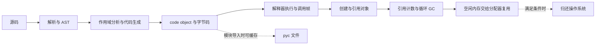

# Python 内存、垃圾回收与执行原理

> 按学习顺序展开：[引用与垃圾回收](/notes/python/runtime/lifecycle.md)、[内存分配与观测](/notes/python/runtime/allocation.md)、[源码、字节码与执行](/notes/python/runtime/execution.md)。

> 入门 / 中等 / 高难各 20 题，共 60 题。★ 是高频。补充 02 的 Python 提纲与 12 的操作系统知识，重点是把「对象如何活着、空间如何复用、代码如何执行」分开讲清楚。
> 以 **CPython 3.12 的常规 GIL 构建**为主。2026-10-22 核对：项目 `../xknow-ai/pyproject.toml` 限定 `>=3.12,<3.13`，Dockerfile 使用 Python 3.12；本机自检为 CPython 3.12.11。不要把这些实现细节当成所有 Python 实现的语言保证。

## 先把几件事分开

| 层次 | 管什么 | 常见误解 |
|---|---|---|
| 变量与引用 | 名字、容器、闭包等如何关联对象 | del 一个名字就销毁对象 |
| 对象回收 | 引用计数与循环 GC 判断生命周期 | 关 gc 就不会释放任何对象 |
| 内存分配器 | 空闲块复用、对象专用缓存、pymalloc/system allocator | 对象销毁后 RSS 必须下降 |
| 操作系统 | 虚拟内存、物理驻留、共享页、容器限额 | 各进程 RSS 相加就是真实独占总量 |
| 编译与执行 | 源码、AST、code object、字节码和解释器 | Python 没有编译，或必须先写 .pyc 才能运行 |

## Python 运行时 入门（20 题）

### 1. ★ Python 与 CPython 有什么区别？
Python 是语言及其规则，CPython 是主要用 C 实现的解释器；PyPy 等是其他实现。引用计数、pymalloc、具体字节码是 CPython 细节，不能仅凭「Python 语法相同」推断内存回收时机相同。

### 2. ★ 变量保存的是对象还是对象引用？
赋值把名字绑定到对象，不会自动复制对象。`a = []; b = a` 中两个名字指向同一个列表；`b.append(1)` 可通过 a 观察到，而 `b = []` 只是换了 b 的绑定。

### 3. is、==、id 分别说明什么？
is 判断是不是同一对象，== 比较值，id 在对象生命周期内标识它。CPython 的 id 通常对应地址，但旧对象销毁后地址可复用；id 不能当跨生命周期的业务唯一编号。

### 4. ★ del 到底删了什么？
`del a` 删除名字绑定，`del xs[0]` 删除容器中的引用，不是强制释放该对象。其他强引用还在，对象就仍可存活；即使对象已销毁，底层内存也可能先留给分配器复用。

### 5. ★ Python 的堆和算法里的堆是一回事吗？
不是。内存堆是动态分配对象的空间；heapq 的堆是优先队列数据结构。普通 CPython 对象由运行时在私有堆上管理，不是说每次创建对象都调用一次系统 malloc。

### 6. 局部变量在栈上，所以函数返回就释放所有对象吗？
不能这样推断。局部名字关联的对象可能被返回值、容器或闭包继续引用；生成器/协程的执行状态还能跨暂停保留。Python 调用帧与原生线程栈也不是一一等同的概念。

### 7. ★ 引用计数的基本原理？
记录强引用的增减，普通对象计数归零时通常开始销毁，这是常规 CPython 中很多对象能及时释放的原因。但不朽对象、终结与对象复活等存在例外，计数也不应被业务代码拿来决定对象所有权。

### 8. 引用计数为什么处理不了循环引用？
a 指向 b、b 指向 a，即使外部引用全没了，内部引用仍使计数不为零。单纯数引用无法判断这一组对象是否已不可达，因此还需循环垃圾收集器识别整组无外部支持的对象。

### 9. ★ 循环 GC 和引用计数如何配合？
引用计数处理大量普通生命周期，循环 GC 补上不可达引用环。GC 不会清理业务仍强引用的缓存；列表里不断积累对象，即使每次 gc.collect 也不能把它们当垃圾删掉。

### 10. 所有对象都会被循环 GC 跟踪吗？
不会。主要跟踪可能构成引用环的对象，例如许多容器和用户实例；整数等一般无需跟踪，部分容器还可优化为不跟踪。`gc.is_tracked` 可观察，不能把 gc.get_objects 当作全部内存对象清单。

### 11. ★ 分代 GC 是什么？
利用许多对象很快死亡、少数对象存活较久的规律，区别扫描频率。CPython 3.12 使用 0、1、2 三代；这是循环 GC 的分组，不表示 Python 有三块独立的 Java 式堆空间。

### 12. 小对象内存池解决什么问题？
减少频繁申请/释放小块内存的系统分配开销。CPython 3.12 默认 pymalloc 优化不超过 512 字节的分配请求；这个数字指请求大小，不是说「字符串字符数不超过 512」就必然走某条路径。

### 13. arena、pool、block 怎么理解？
可把它们理解为较大内存区、其中按大小类管理的池、实际分配块。相同大小类复用空闲块，减少零碎系统分配；它们是分配层次，不是 GC 的年轻代、老年代。

### 14. ★ 为什么小整数也有内存开销？
Python 对象除了值还有类型、管理信息及对齐等开销；列表还保存元素引用和预留容量。不能按「一百万个数字×8 字节」直接估普通 list[int]，需要考虑共享对象与实际结构。

### 15. sys.getsizeof 会递归统计对象吗？
通常不会，它返回对象自身报告的大小，容器指向的对象不会全算进去。列表自身不大，元素却可能持有巨大内容；共享元素也不能在深度统计时重复累加。精确值还依平台与版本而变。

### 16. ★ 弱引用有什么作用？
允许观察对象而不靠该弱引用延长其寿命，适合一些缓存和观察者。弱引用不提供永久可用保证；取出后先用局部强引用保住，再检查是否为 None，不要分两次读取并假设结果相同。

### 17. __del__ 是可靠的资源释放方式吗？
不可靠，执行时机、解释器退出、异常与对象复活都可能影响它。文件、锁、数据库连接优先用 with 或明确 close，垃圾回收只能作部分兜底，不能承担事务提交和业务成功确认。

### 18. ★ Python 代码如何执行？
CPython 读取源码，解析成 AST，分析作用域并生成 code object/字节码，再由解释器执行。模块可利用有效字节码缓存省掉一部分编译过程；「解释型」不表示没有编译阶段。

### 19. 字节码和机器码有什么区别？
字节码是解释器理解的指令，机器码直接对应目标 CPU 指令集。CPython 主程序自身由 C 编译器等构建成机器程序；应用 Python 源码编译到字节码是另一个层次，不能混为同一次编译。

### 20. ★ .pyc 文件是不是运行的必经步骤？
不是。code object 可只在内存里生成和执行，模块导入常把字节码缓存到 __pycache__。直接运行主脚本不要求先写出它的 .pyc，缓存目录不可写也不意味着正常源码绝对无法执行。

## Python 运行时 中等（20 题）

### 1. ★ 循环 GC 怎么知道一个环已经没有外部引用？
概念上对候选对象的引用计数做临时分析，扣除候选内部引用，找出仍有外部支持的对象，再保留从它们可达的部分；剩余不可达部分可回收。不是看到互相引用就删，也不是只要计数大于零就保留。

### 2. ★ CPython 3.12 的 GC 什么时候触发？
自动收集与分配/释放计数和代际阈值有关，不是每隔固定几秒扫描，也不是「第 700 个对象必定立刻 full GC」。用 gc.get_count/get_threshold/get_stats 观察，触发条件与实际运行收集的安全时点要区分。

### 3. gc.disable 和 gc.collect 有什么关系？
gc.disable 关闭自动循环收集，不关闭引用计数；手动 gc.collect 仍可执行。用前确认是否产生环，恢复原状态；不要在 collector 正在执行时递归调用 collect，也别为追求一次延迟数据长期漏掉循环垃圾。

### 4. ★ gc.garbage 很长就一定是解释器无法回收吗？
不一定。DEBUG_SAVEALL 会把原本可清理的不可达对象也保存在 gc.garbage，DEBUG_LEAK 包含这一行为。先核对 debug flags，排查结束恢复设置并释放诊断引用，避免诊断工具自己留住垃圾。

### 5. 有 __del__ 的循环引用现在还能回收吗？
现代 CPython 对普通 Python 终结器已有安全终结支持，不能继续背「有 __del__ 的环一定泄漏」。C 扩展终结器、复活和复杂资源依赖另有边界；PEP 442 从 Python 3.4 引入相关改变。

### 6. ★ 闭包、异常和生成器怎样让对象活得更久？
闭包 cell/defaults 可持有对象；保存 traceback 可保留帧及其局部对象；暂停的生成器/协程可保留执行状态。不是函数已返回就万事清理，排查要找真正持有引用的链路及释放时机。

### 7. lru_cache 为什么可能占用越来越多内存？
缓存会强引用键和值，maxsize=None 可无界增长，有限条数也可能每条很大；缓存实例方法时键还可能持有 self。按调用模式与每条大小设预算，失效和生命周期明确，别以「命中率高」证明不会泄漏。

### 8. ★ WeakValueDictionary 和 __slots__ 有什么限制？
弱值表不保活值，不适合承诺结果一直存在；对象必须支持弱引用。常见纯 slots 类要加入 __weakref__ 才能弱引用；继承链可能已经提供它，不能在所有子类里重复声明后还认为布局一定相同。

### 9. 深度计算对象大小为什么难？
需要去重共享对象并防环，还需决定是否算类、模块、外部缓冲与分配器开销。递归 getsizeof 得到的只是所选边界下估算；同一对象在多个容器里出现，不代表实际内存被复制了多份。

### 10. ★ 为什么对象释放了，RSS 仍不下降？
空闲块可能留在 freelist、pymalloc arena 或系统分配器中，碎片使区域仍有活块，也可能只是高水位缓冲。RSS 是驻留页指标，不等于活对象大小；应同时看活分配、引用链、RSS 和后续是否复用。

### 11. PyMem、PyObject 与 malloc 能混着释放吗？
不能。C 扩展必须按分配域与 API 配对，如 PyMem_Malloc/PyMem_Free，不能用 free 释放 Python 管理器分配的对象。错误配对可能内存破坏，不是简单少执行一次 GC；不同构建还可能换分配器。

### 12. ★ RSS、USS、PSS 各适合看什么？
RSS 包含该进程驻留的共享页，多进程直接相加可能重复；USS 关注独占页，PSS 按共享比例摊分。容器是否 OOM 还取决于 cgroup 记账与限制；指标需注明系统与采集工具，不把一种数字当全部内存真相。

### 13. tracemalloc 能看到所有原生内存吗？
它追踪接入 Python 内存追踪机制的分配，不能默认覆盖 C 库直接 malloc、GPU 内存或全部 mmap。尽早启动并比较相同负载前后快照；若 RSS 涨而跟踪量稳定，继续调查原生缓冲和其他驻留来源。

### 14. ★ 生成器、array、memoryview 怎样省内存？
生成器按需产出，array 等紧凑结构减少逐对象成本，memoryview 可避免一些拷贝。但惰性生成器仍可能握着大输入，view 也可能保活整个底层 buffer；省拷贝和省存活内存要分别测。

### 15. tokenizer、parser、AST、符号表分别做什么？
词法分析识别名字/字面量/缩进等，解析器组织语法结构，AST 表示程序语义结构，作用域分析判断局部/自由/全局名字。后续生成与优化指令；CPython 3.12 使用 PEG 解析器，具体中间步骤属于实现细节。

### 16. ★ code object、function、frame 的区别？
code object 保存编译后的指令及常量等元数据；function 还带全局命名空间、默认参数和闭包等；frame 是一次执行的状态。相同函数递归调用可有多份执行帧，不能把函数对象和某次调用混为一体。

### 17. 为什么函数里读 x 会抛 UnboundLocalError？
编译期作用域分析通常会因函数体内给 x 赋值而将其判为局部；实际执行在赋值前读它就失败，不自动退回全局。global/nonlocal 用来明确绑定范围；不是所有名字都完全在运行时随意逐层试。

### 18. ★ compile、eval、exec 分别做什么？
compile 把字符串/AST 生成 code object，不代表执行；eval 执行表达式，exec 执行语句代码。传入自定义 globals 也不构成可靠沙箱，不执行不可信代码；本篇实验只编译和执行固定示例字符串；优化模式可移除 assert，安全校验不能依赖 assert。

### 19. .pyc 与 sys.modules 是哪两层缓存？
.pyc 是磁盘字节码缓存，正常导入按版本/有效性规则检查；sys.modules 保存本解释器中已加载模块对象。删 .pyc 不会让常驻进程重新执行已导入模块，也不会自动修复模块级缓存持有的大对象。

### 20. ★ 自适应特化和 JIT 有什么区别？
CPython 3.11 起可按运行时类型等信息特化部分字节码，减少通用处理；这不等于项目已启用原生代码 JIT。JIT 把热路径编译到更低层机器执行形式，支持与启用条件依版本/构建；本项目限定 3.12，不能当成已有 JIT。

## Python 运行时 高难（20 题）

### 1. ★ RSS 一直涨，tracemalloc 基本不变怎么排查？
先确认追踪启动时机和负载是否可比，再看原生扩展、文件映射、线程栈、缓冲、共享页与分配器碎片。用 OS 指标和能覆盖原生分配的工具补证据；只多调几次 gc.collect 无法解释未被追踪的全部空间。

### 2. ★ 怎么证明有真正的引用泄漏？
固定负载重复运行，比较清理后的活分配与对象数量，找到持续增长的分配位置，再追持有链，例如全局 dict→回调→闭包→大对象。tracemalloc 说明哪里分配，不直接证明谁保活；诊断列表和快照也有开销。

### 3. GC 暂停导致 P99 抖动怎么验证？
低开销记录 gc.callbacks 的 start/stop、代际与耗时，关联请求长尾，并区分引用计数销毁、循环收集和其他 CPU 工作。先减少环与短命大图，再评估阈值；实验固定版本和负载，不先关 GC 宣称问题已解决。

### 4. ★ fork 后只读数据为什么逐渐变成独占页？
部分普通对象访问会产生引用计数写入，GC 也可能改管理元数据，触发写时复制。gc.freeze 可减少冻结对象被循环收集扫描时的写入，不能消除所有引用计数/业务写；用 PSS/USS 和私有脏页评估。

### 5. free-threaded 构建怎样影响这些结论？
引用管理、同步、收集触发与分配器可能不同，不能把常规 GIL 构建的时机和性能全照搬。官方 3.14 文档列出 free-threaded 使用 mimalloc；移除 GIL 也不免除应用共享状态加锁，扩展兼容性需核对。

### 6. ★ 给 Agent/Celery 进程估内存预算怎么做？
列基础常驻、每个在途任务峰值、解析子进程、模型/文件缓冲、缓存和发布重叠，再留余量。并发数乘任务平均内存会低估尖峰；项目用 gevent，不能把 prefork 的每子进程自动回收配置当通用兜底。

### 7. 用了生成器为何导出仍 OOM？
可能上游驱动已全部缓冲、下游 list/排序/拼接重新聚合，或每条对象仍被缓存/集合持有。逐段检查读取、转换、输出和关闭责任；分批读取加按需写出，且处理慢接收方的背压。

### 8. ★ C 扩展如何接入循环 GC？
可能持有 Python 引用并参与环的扩展类型，要按 C API 约定实现遍历/清理等 GC 支持，正确管理引用和分配域。漏报引用会漏收，错误清理可能悬空；这是扩展开发问题，Python 层 collect 无法修补错误 C 所有权。

### 9. 对象复活为什么让 __del__ 更难预测？
终结器可把 self 存入其他活容器，让对象重新可达；不要把终结器已跑当成对象已经彻底死亡。终结顺序与复活后再次终结的规则有实现差异，资源释放尽量幂等且不依赖全局模块仍完整存在。

### 10. ★ weakref.finalize(obj, obj.close) 为什么可能失效？
绑定方法强引用 obj，finalize 持有回调，结果反而把目标保活。回调不应直接或间接引用目标，可使用独立资源句柄；仍优先明确 close/with，finalize 只是兜底，不负责可靠业务动作。

### 11. __slots__ 为什么没有预期节省？
实例数少、字段本身很大、父类已有 __dict__、子类重新引入字典，都会削弱收益。看同样模型的整体分配而不是只比较 sys.getsizeof(instance)，还要验证序列化、继承和弱引用需求。

### 12. ★ 递归深度限制和 C 栈溢出是一回事吗？
不是。Python 递归限制是运行时保护，现代 CPython 的 Python 帧与原生调用栈关系也在演进。调高 sys.setrecursionlimit 不保证安全，递归处理超深输入优先改显式栈；不要承诺尾递归自动消除。

### 13. AST 能解析为什么仍然无法编译/执行？
AST 主要表示结构，作用域和上下文约束还可能使 compile 失败，例如模块顶层 return；成功编译后也可能有 NameError、导入失败和业务错误。语法解析、编译通过与实际执行正确是三个层次。

### 14. ★ .pyc 可以作为保密或安全校验吗？
不能，字节码和常量可被分析，且依赖解释器格式。缓存校验用于判断是否需要重编，不等同可信来源签名；部署仍需控制包来源和文件权限，不把「没有 .py」当作源码已不可恢复。

### 15. 升级 Python 后快了，如何判断原因？
固定依赖、硬件/配额、输入、并发、预热和构建选项，多次测吞吐、分位延迟、CPU 与内存。编译时间、导入缓存、字节码特化和扩展版本都可能影响；官方基准平均提升不是本项目的实测收益。

### 16. ★ 一个字节码能保证线程安全吗？
不能据此建立业务同步。字节码会随版本变，运行时可能调用用户方法或释放 GIL，复合读改写更不保证原子。需要不变量时用锁或原子接口；free-threaded 下尤其不能依赖旧的 GIL 偶然性。

### 17. fork 后复制的不只是 Python 对象，项目要注意什么？（项目）
还会继承连接/锁等状态。`app/gunicorn_conf.py` 在 post_fork 中对各 Engine 执行 dispose(close=False)，丢弃继承池状态，避免 worker 共用父进程建出的连接。这个连接生命周期修复不等于减小对象内存或实现共享堆。

### 18. ★ 每请求调用 gc.collect 能避免 OOM 吗？
通常不能。它无法回收仍有强引用的缓存，也不保证原生分配器归还驻留页，还会增加延迟；释放大对象本身也可能耗时。先查峰值、泄漏、缓存和并发，再只在可测收益的受控场景考虑主动收集。

### 19. Python 3.14 是两代还是三代，怎么回答稳妥？
先报补丁版本和构建。官方维护文档记载：3.14 初始移除 generation 1、采用增量收集；3.14.5 又恢复中间代及相关行为。不要背「3.14 永远只有两代」；项目 3.12 则按三代解释。本篇没有用本机 3.12 实验冒充验证 3.14。[版本依据](https://docs.python.org/3.14/library/gc.html)

### 20. ★ 怎么完整回答「Python 内存为什么不释放」？
先问指名字、对象、分配块还是 RSS。再检查强引用/环→引用计数与循环 GC→分配器复用与碎片→原生缓冲和 OS 驻留，最后用快照、持有链和进程指标验证；每层都有不同证据，不能一句「Python 有 GC」就结束。

## 面试口述与自测

**一分钟口述：**「我先按项目的 CPython 3.12 解释。普通对象主要靠引用计数管理生命周期，循环 GC 补上不可达引用环；回收对象后，空间常由分配器复用，不保证 RSS 马上下降。代码先编译成 code object 和字节码，再由解释器执行，.pyc 主要是导入缓存。排查内存时先区分强引用积累、循环、原生分配和碎片，再结合 tracemalloc、引用链与进程指标。」

[verify_20.py](/posts/interview/Guide/Scripts.md#verify-20-py)直接运行固定小实验并断言：别名与 del、循环 GC、关闭自动收集后手动 collect、现代终结器、弱引用、闭包/traceback/生成器持有对象、slots、缓冲区保活、AST/compile/执行的区别、字节码、临时 .pyc 与 tracemalloc 分配释放。源码内有说明，不启动项目服务。

在 Workspace 执行：`xknow-ai/.venv/bin/python -I 面试准备/验证/verify_20.py`。实验不对 RSS 下降、字节码偏移、对象固定地址或精确 GC 计数作不稳定断言，也不进行危险的内存耗尽、递归溢出或不可信代码执行。

## 官方资料

| 主题 | 资料 |
|---|---|
| 引用、对象与生命周期 | [Python 3.12 数据模型](https://docs.python.org/3.12/reference/datamodel.html) |
| 循环 GC、阈值、调试与 freeze | [Python 3.12 gc](https://docs.python.org/3.12/library/gc.html) |
| 小对象分配与 API 配对 | [Python 3.12 内存管理](https://docs.python.org/3.12/c-api/memory.html) |
| 大小度量与弱引用 | [sys.getsizeof](https://docs.python.org/3.12/library/sys.html#sys.getsizeof)、[weakref](https://docs.python.org/3.12/library/weakref.html) |
| 分配快照与追踪边界 | [tracemalloc](https://docs.python.org/3.12/library/tracemalloc.html) |
| 终结器与循环 | [PEP 442](https://peps.python.org/pep-0442/) |
| AST、字节码与缓存 | [ast](https://docs.python.org/3.12/library/ast.html)、[dis](https://docs.python.org/3.14/library/dis.html)、[py_compile](https://docs.python.org/3.12/library/py_compile.html) |
| 自适应特化与新构建 | [3.11 执行优化](https://docs.python.org/3.12/whatsnew/3.11.html#faster-cpython)、[free-threading](https://docs.python.org/3.14/howto/free-threading-python.html)、[3.14 分配器](https://docs.python.org/3.14/c-api/memory.html) |

核对日期：2026-10-22。新版本资料是迁移参考，项目的安装范围与本机运行结果以篇首为准。
